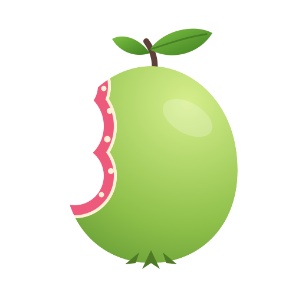
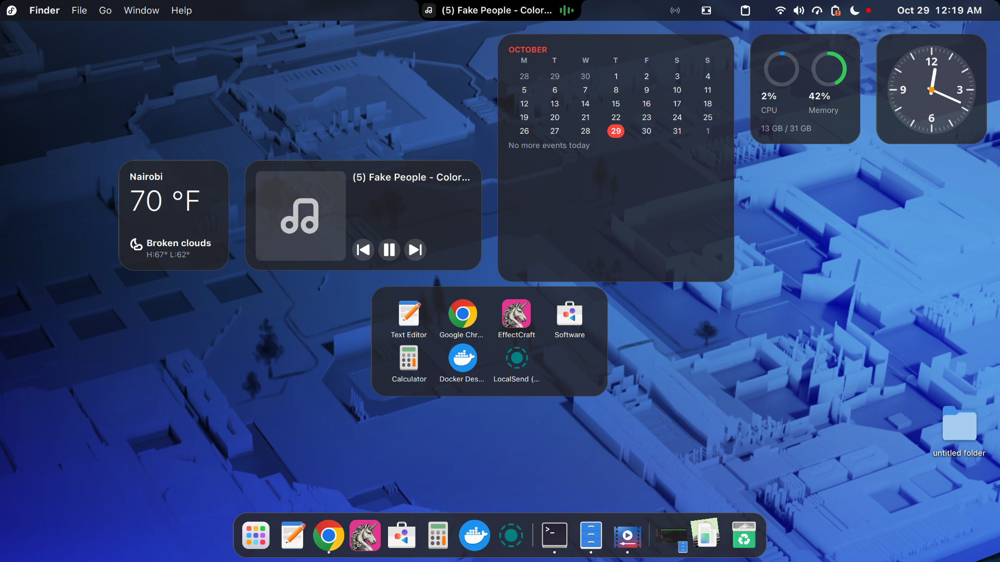
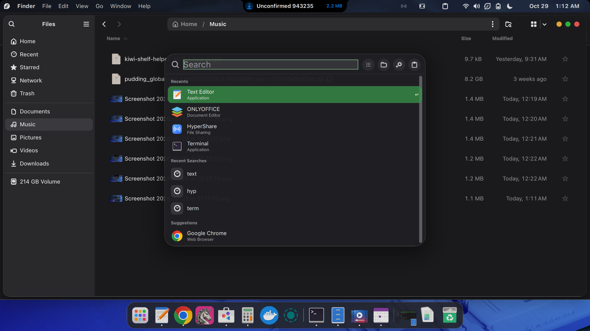
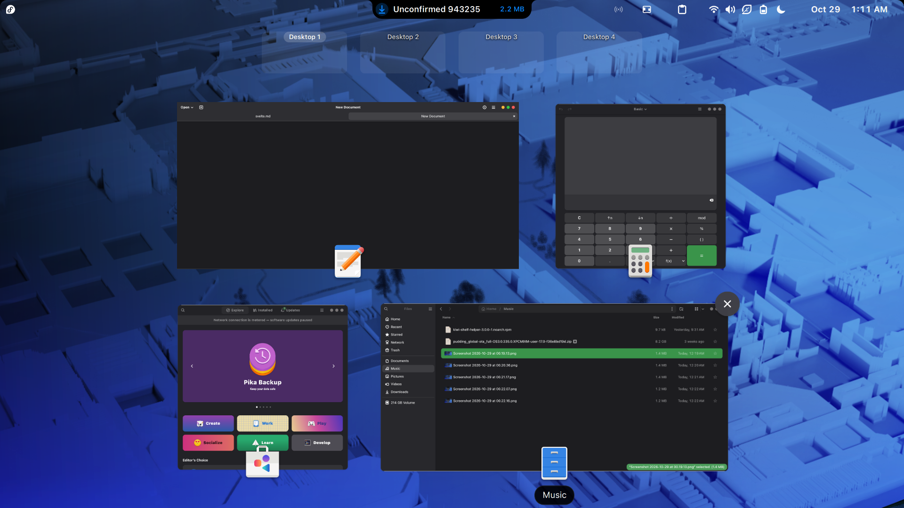
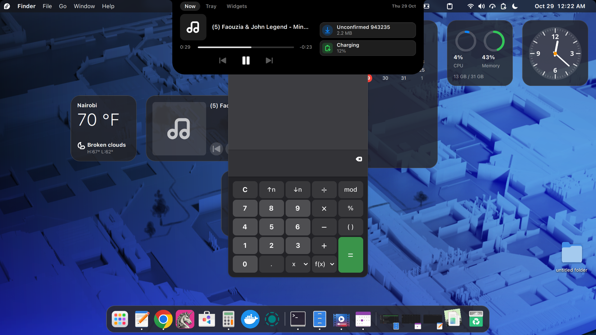
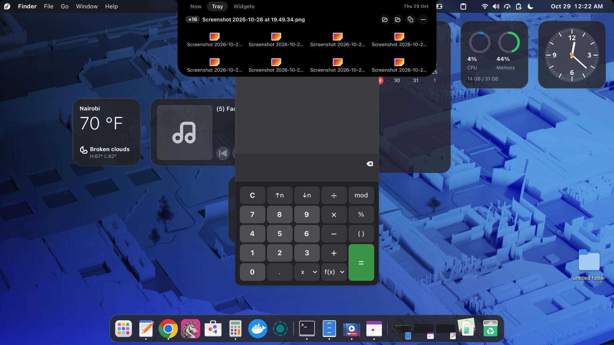
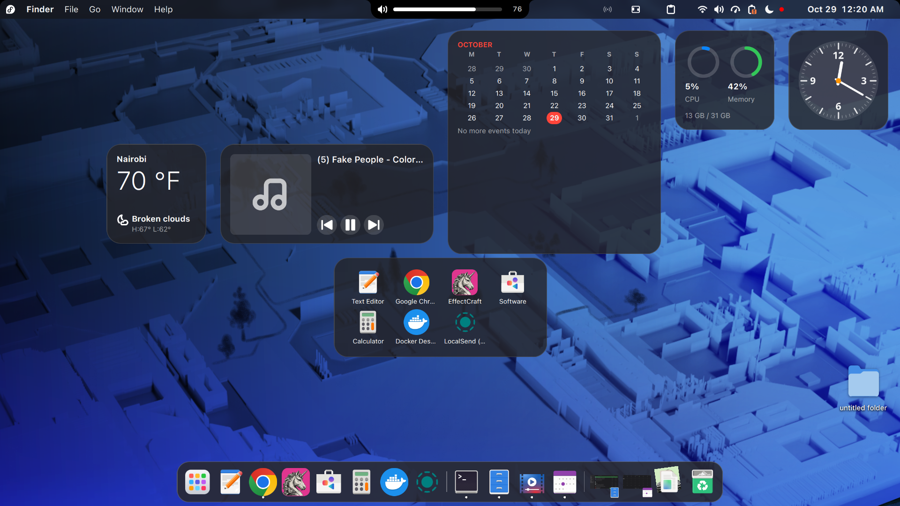
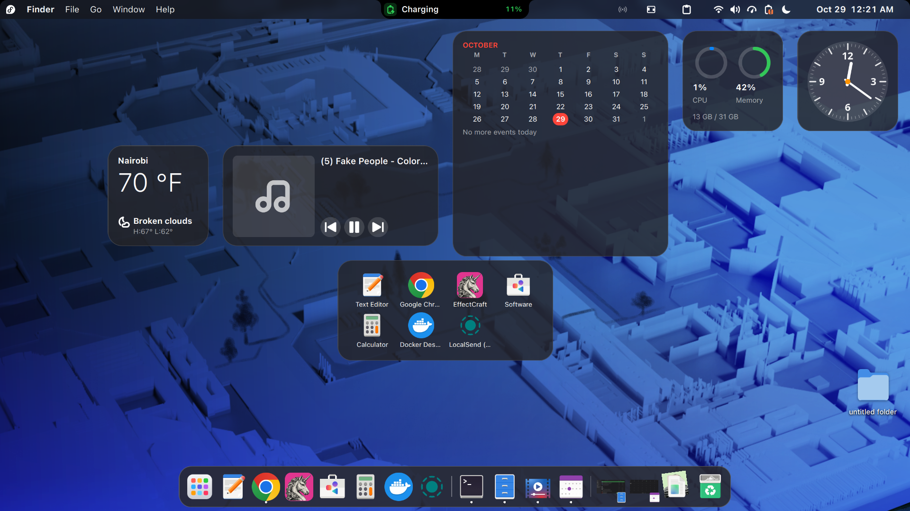

<p align="center"></p>

<h1 align="center">Guava OS</h1>

<p align="center"><b>The macOS desktop, grown on GNOME.</b></p>

<p align="center">
  
  
</p>

## What is Guava OS?

Guava OS turns a GNOME desktop into a Mac-style one. It is a **GNOME Shell extension**, not a
separate operating system: you keep your Linux system, your apps and your files, and Guava OS
reshapes the desktop around them. That means a transparent menu bar with app menus, a dock with
Genie minimize, Mission Control, Spotlight, a Control Center, a notch with live activities and
much more, all in one design language.

- **One coherent desktop.** Every part shares the same glass, type, spacing and motion, so the
  menu bar, dock, popups and dialogs look like they belong together.
- **macOS defaults, your choice.** Out of the box it behaves like a Mac. Every feature has its own
  switch in Preferences, and turning one off gives GNOME's own behaviour back.
- **Leaves your system alone.** Guava OS changes GNOME settings only while a feature that needs
  them is on, and restores your own values when it turns off. It never deletes files it did not
  create.
- **Built for GNOME 50.** Tested on Fedora 44 Workstation with Wayland.

Guava OS is unofficial and not affiliated with Apple. It grew out of the
[Kiwi (is not Apple)](#credits) extension.

## Showcase

<p align="center">
  
  <br><sub>The desktop: the menu bar with the focused app's menus, the notch, desktop widgets and the dock</sub>
</p>

<table>
  <tr>
    <td width="50%"><br><sub><b>Spotlight</b>: tap Super to search apps, files, settings and more</sub></td>
    <td width="50%"><br><sub><b>Mission Control</b>: every window at a glance, Spaces along the top</sub></td>
  </tr>
  <tr>
    <td><br><sub><b>Notch, Now</b>: media controls and live activities</sub></td>
    <td><br><sub><b>Notch, Tray</b>: a shelf for the files you are working with</sub></td>
  </tr>
  <tr>
    <td><br><sub><b>Volume</b> and brightness show in the notch</sub></td>
    <td><br><sub><b>Live activities</b> such as charging</sub></td>
  </tr>
</table>

## What you get

Every area has its own page in [docs/features](docs/features/README.md), with its settings,
limits and where it lives in the code.

**Menu bar**
- A transparent menu bar with the guava logo menu (About This PC, System Settings, Force Quit, Sleep, Restart, Shut Down, Lock Screen, Log Out). The logo can be the guava, Fedora's or none.
- The focused app's name and menus, from GTK menu bars and from Qt, Electron and LibreOffice apps under Xwayland; other apps get File, Edit, Window and Help. Help search finds any menu item, and Ctrl+F2 reaches the menus from the keyboard. See [app menus](docs/features/app-menus.md).
- App status icons, Control Center controls you pin to the bar, item order and an overflow chevron.
- Privacy dots (microphone, camera, screen sharing), Force Quit (Super+Alt+Esc), and the clock and calendar at the right.

**Windows**
- Window buttons on each app's own title bar, in the macOS traffic-light look or GNOME's own.
- Sequoia-style tiling: drag to an edge, a corner or the top bar, or to the top centre for snap layouts (halves, thirds, quarters). Ctrl+Super shortcuts for halves, Fill, Center, Return to Previous Size and multi-window arrangements.
- Full screen in its own Space, Split View, Hide and Hide Others (Super+H, Alt+Super+H), Show Desktop (Super+D) and rounded window corners.

**Dock**
- Pinned, running and recent apps, badges and progress, bounce, Downloads and folder Stacks (Fan, Grid, List) and the Trash, at the bottom or on a side.
- Genie or Scale minimize, magnification and auto-hide.

**Stage Manager, Mission Control and Launchpad**
- Stage Manager: the window you work in at the centre, your other apps as live previews in a strip. Off by default.
- Mission Control (F3, Ctrl+Up) with a Spaces bar, and App Exposé (Ctrl+Down).
- Launchpad (Super+A, F4) with pages, search, folders and jiggle mode.
- The app switcher (Super+Tab or Alt+Tab, Super+` for the front app's windows), trackpad gestures and hot corners.

**Spotlight and the clipboard**
- Tap Super to search apps, files, settings, the clipboard, a calculator and the web, with `/` filters, Quick Keys, history, Quick Look and the focused app's menu items.
- Clipboard history with a popover and Quick Paste. It stays on your computer, and password-manager copies are skipped.

**Control Center, notifications and the notch**
- Quick Settings laid out as a Control Center, with Edit Controls and Low Power Mode.
- Notification Center (click the clock) and Focus modes with schedules and app triggers.
- A notch at the top centre for notifications, live activities (media, timers, recording, charging, headphones, next event, downloads, one-time codes) and volume. Hover to open Now, Tray (a file shelf) and Widgets.

**Desktop, input and look**
- Desktop widgets and Finder-style desktop icons.
- Screenshots (Shift+Super+3, 4, 5) with a toolbar and a floating thumbnail; Emoji & Symbols (Super+Ctrl+Space); a Caps Lock and input-source badge at the text cursor.
- Liquid Glass translucency, Auto Light and Dark, accent and highlight colours, icon styles, macOS-style text rendering, and a Setup Assistant on first login.

## Install

Guava OS supports **GNOME Shell 50**.

### From a release

Download from the [releases page](https://github.com/blueyzx64/guava-os/releases):

- `guava-os@blueyzx64.shell-extension-<version>.zip`: the extension.
- `guava-shelf-helper-<version>.noarch.rpm` (optional): lets you drag files out of the notch's shelf into other apps. Without it the shelf keeps its Open and Copy actions.

```sh
gnome-extensions install --force guava-os@blueyzx64.shell-extension-<version>.zip
sudo dnf install ./guava-shelf-helper-*.noarch.rpm   # optional
```

Log out and back in (GNOME on Wayland cannot restart the Shell in place), then:

```sh
gnome-extensions enable guava-os@blueyzx64
```

You can also use the Extensions app. Preferences: `gnome-extensions prefs guava-os@blueyzx64`.

### From source

```sh
sudo dnf install git make gettext
git clone https://github.com/blueyzx64/guava-os.git
cd guava-os
make install       # builds the zip in dist/ and installs it for your user
make helper-rpm    # optional: builds the shelf helper RPM (needs rpm-build)
```

Then log out and back in, and run `gnome-extensions enable guava-os@blueyzx64`.

### Coming from Kiwi?

Guava OS is its own extension, with its own settings (`/org/gnome/shell/extensions/guava-os/`),
so it installs next to Kiwi without touching Kiwi's settings. Turn Kiwi off before you turn Guava
OS on: both take over the same parts of the Shell.

## Your first login

Everything starts the macOS way, and you can change each part in Preferences.

- The Setup Assistant opens once in Preferences. Not Now keeps the defaults; run it again any time from About.
- The menu bar is transparent, with the guava menu and the focused app's menus.
- The dock sits at the bottom with Genie minimize; magnification and auto-hide are off.
- Tap Super for Spotlight. F3 or Ctrl+Up opens Mission Control, Ctrl+Down App Exposé, Super+A or F4 Launchpad. Click the clock for the Notification Center.
- The notch is on. Stage Manager and hot corners are off, and no desktop widgets are placed until you add some (right-click the desktop, Edit Widgets).
- Clipboard history is on, with no shortcut until you set one (Super+Shift+V in Preferences).

## Update and uninstall

```sh
cd guava-os && git pull && make install      # update from source, then log out and back in
```

```sh
gnome-extensions disable guava-os@blueyzx64   # turn it off; GNOME's own settings come back
make uninstall                                # or: gnome-extensions uninstall guava-os@blueyzx64
sudo dnf remove guava-shelf-helper            # if you installed the helper
```

Clipboard history is kept in `~/.local/share/guava/clipboard/`; delete that folder to remove it.
To back up your settings: `dconf dump /org/gnome/shell/extensions/guava-os/ > guava-os.ini`.

## Known issues

- Qt and Electron app menus reach the menu bar only when those apps run under Xwayland. See [app menus](docs/features/app-menus.md).
- Electron and KDE apps draw their own title bars on Wayland, so their window buttons can look different. To run them under Xwayland: `--ozone-platform=x11` for Electron, `QT_QPA_PLATFORM=xcb` for Qt.
- Spaces are shared across displays, because GNOME has no per-display workspaces.
- Flatpak GTK apps need these overrides to see the traffic-light title bar style:

  ```sh
  flatpak override --user --filesystem=xdg-config/gtk-3.0:ro
  flatpak override --user --filesystem=xdg-config/gtk-4.0:ro
  flatpak override --user --filesystem=$HOME/.local/share/gnome-shell/extensions/guava-os@blueyzx64/:ro
  ```

- A two-finger swipe from the trackpad edge cannot open the Notification Center (GNOME gives the Shell only three- and four-finger gestures). Click the clock or use a hot corner.

Found a bug? Watch the log while it happens and include any `[Guava]` lines in your
[issue](https://github.com/blueyzx64/guava-os/issues):

```sh
journalctl -f -o cat /usr/bin/gnome-shell | grep -i guava
```

## Use it with

These extensions work well alongside Guava OS (also listed in Preferences > About):

| Extension | Author | Notes |
|---|---|---|
| [AppIndicator and KStatusNotifierItem Support](https://extensions.gnome.org/extension/615/) | 3v1n0 | Tray icons. While it is on it draws the app icons, and Guava OS only orders and hides them. |
| [Blur my Shell](https://github.com/aunetx/blur-my-shell) | aunetx | Real blur. Use it or Guava OS's Liquid Glass for each surface, not both. |
| [Compiz alike magic lamp effect](https://extensions.gnome.org/extension/3740/) | hermes83 | Another minimize animation; turn Genie off if you use it. |
| [Superbar](https://github.com/Furkan-rgb/superbar) | Furkan-rgb | See its page. |
| [Light Style](https://extensions.gnome.org/extension/6198/) | fmuellner | A light Shell style. |
| [Weather or Not](https://extensions.gnome.org/extension/5660/) | somepaulo | Weather in the top bar. |

Guava OS steps aside on its own for [Dash to Dock](https://extensions.gnome.org/extension/307/dash-to-dock/)
(turned off while Guava's dock runs, back on when it stops) and
[Desktop Icons NG](https://extensions.gnome.org/extension/2087/desktop-icons-ng-ding/) (Guava's
desktop icons stay idle while it is on), so you can keep both installed.

## Contributing

`make check` runs lint, the schema check, the stylesheet check and the unit tests. `make pack-check`
packs the zip and checks its contents. `make smoke` starts a headless GNOME Shell and turns Guava OS
on and off many times without touching your session ([tools/smoke/README.md](tools/smoke/README.md)).
The code layout is in [docs/architecture/code-map.md](docs/architecture/code-map.md), and the rules
for writing a feature are in [docs/architecture/conventions.md](docs/architecture/conventions.md).

To help translate Guava OS, see the [translation guide](translating/README.md).

## Credits

Guava OS is based on **[Kiwi (is not Apple)](https://github.com/blueyzx64/kiwi-is-not-apple)**,
which began as **[kiwi-kemma](https://github.com/kem-a/kiwi-kemma)** by Arnis Kemlers
([kem-a](https://github.com/kem-a)). Thanks to everyone who built them; their work is the root
Guava OS grew from. More from the Kiwi author: [Kiwi Menu](https://github.com/kem-a/Kiwi-Menu),
[AppManager](https://github.com/kem-a/AppManager),
[Catalina Reloaded icons](https://github.com/kem-a/Catalina-reloaded) and
[GDM Wallpaper](https://github.com/kem-a/gnome-gdm-wallpaper).

These projects helped shape parts of Guava OS, as references for how to do something in GNOME
Shell or as extensions a feature had to work alongside:

| Project | Where it helped |
|---|---|
| [Hide Top Bar](https://github.com/mlutfy/hidetopbar) | Panel hiding and pressure barriers |
| [Clipboard Indicator](https://github.com/Tudmotu/gnome-shell-extension-clipboard-indicator) | Reading the clipboard in the Shell |
| [Blur my Shell](https://github.com/aunetx/blur-my-shell) | Blur in the Shell; Liquid Glass is built to coexist with it |
| [Dash to Dock](https://extensions.gnome.org/extension/307/dash-to-dock/) | The dock hand-off |
| [Desktop Icons NG](https://extensions.gnome.org/extension/2087/desktop-icons-ng-ding/) | The desktop icon and widget layers |
| [AppIndicator Support](https://extensions.gnome.org/extension/615/) | The menu bar's status icon host |
| [Hanabi](https://github.com/jeffshee/gnome-ext-hanabi) and [Desktop Clock](https://extensions.gnome.org/extension/5156/desktop-clock/) | Desktop widgets and wallpaper layers |
| [Screencast Extra Feature](https://extensions.gnome.org/extension/8764/screencast-extra-feature/) | The screenshot and recording toolbar |

## License

Guava OS is free software under the **GNU General Public License v3.0 or later**; see
[LICENSE](LICENSE). Copyright © 2025 Arnis Kemlers (Kiwi) and © 2026 blueyzx64 (Guava OS).
The guava logos in [assets/logo](assets/logo) are Guava OS's own.
